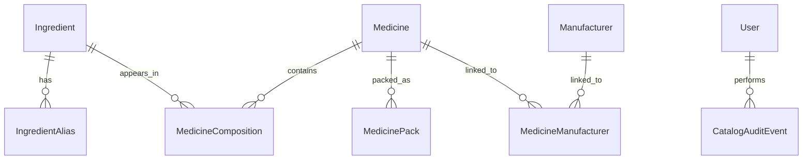

# Canonical medicine catalog

The catalog is shared reference data. It is not owned by a retailer or a distributor. Supplier price, stock, and pack availability belong on a future listing, not on these rows.

## Entities

- **Medicine.** One canonical product: display name, optional brand name, generic name, dosage form, and an optional presentation string used for search. Strength is not stored as a single field on the medicine.
- **Ingredient.** A normalized active ingredient or salt. Similar spellings stay separate until an admin creates an alias.
- **Ingredient alias.** An exclusive alternate name. It cannot match another ingredient's normalized name or alias.
- **Manufacturer.** The company that manufactures or markets the product. This is not a distributor organization.
- **Medicine manufacturer.** Links a medicine to one or more companies with role `MANUFACTURER` or `MARKETER`.
- **Composition.** One ingredient on one medicine, with a numeric strength, a unit, an optional basis such as `per 5 ml`, and a sequence.
- **Pack.** A marketed pack of a medicine, with a description, a quantity, and a unit. The quantity is the pack size, not stock on hand.
- **Catalog audit event.** Actor user id, action, entity type, entity id, and timestamp. It does not store tokens or email addresses.

## Names

`normalizeCatalogName` trims, lowercases, and collapses whitespace. It does not remove punctuation or merge names that merely look alike. `paracetamol` and `paracetamol hydrochloride` are different ingredients.

Ingredient and manufacturer normalized names are unique. Alias normalized text is unique across all aliases. A medicine's normalized display name is unique, so two strengths of the same brand need distinct display names until a pharmacist reviews a richer key.

Dosage form is free text. A controlled list still needs pharmacy review.

## Composition and packs

Strength is a decimal with scale 6 and a unit of `MG`, `MCG`, `G`, `ML`, `IU`, or `PERCENT`. The API strips trailing zeros. MedStock does not convert units. `basis` keeps source wording such as `per 5 ml`.

An ingredient appears at most once on a medicine. Sequence is unique per medicine.

A pack is unique per medicine by its description. The same count in two descriptions can both exist. Barcodes and GTINs are not stored. No licensed barcode source has been approved.

## Lifecycle

`DRAFT` to `PUBLISHED`, `DRAFT` to `ARCHIVED`, and `PUBLISHED` to `ARCHIVED` are allowed. Archived medicines stay archived. Published and archived medicines are not edited in place. Search visibility is separate: a published medicine can be hidden. Ordinary search and ordinary reads return only rows that are `PUBLISHED` and `searchVisible`. A platform admin can read a draft or hidden medicine by id. Distributor submissions are stored separately and are not searchable until a platform admin approves one into this lifecycle.

New medicines start as drafts and are not searchable. `sourceLabel` defaults to `manual`. `sourceReference` is an optional note. No external medicine file is loaded by this task.

## Search

Search reads `medicines.search_text`, which the catalog service rebuilds from the display name, brand, generic name, dosage form, presentation, ingredient names, aliases, manufacturer names, and pack descriptions.

PostgreSQL `pg_trgm` indexes `search_text` for partial matches. A GIN index on `to_tsvector('simple', search_text)` supports word match. Prisma cannot declare that expression index or the extension, so both are added in the catalog migration.

Results are ordered by text rank, then `word_similarity`, then display name, then id. Page size is at most 50. The search summary does not include composition or packs. A caller that needs them reads `GET /catalog/medicines/:medicineId`. The retailer search page does that for the current page of results.

Limits: the `simple` dictionary does not stem medical words, so `tablets` does not match `tablet`. `word_similarity` uses a threshold of 0.4 against the whole document, so a short typo inside a long document can miss. There is no Elasticsearch index.

## Authorization

Catalog writes require an active `PLATFORM_ADMIN` membership on a `PLATFORM` organization. The actor is the user resolved from the verified bearer token. A role in the request body is rejected by the strict schema and is never read as authorization.

Reads require a verified identity. They do not require a platform-admin membership.

## Future import

A distributor submission proposes a new medicine, its salts, packs, and inventory details. It stays pending until a platform admin approves it. Approval publishes the catalog medicine and keeps the proposed price, MOQ, and stock on the submission. It does not create an active listing.

Do not import an external medicine file until its license and permitted use are recorded. An import should write `sourceLabel` and `sourceReference`, keep invalid rows out of the catalog, and report those rows. It should not partially publish a medicine. That workflow is not implemented.
