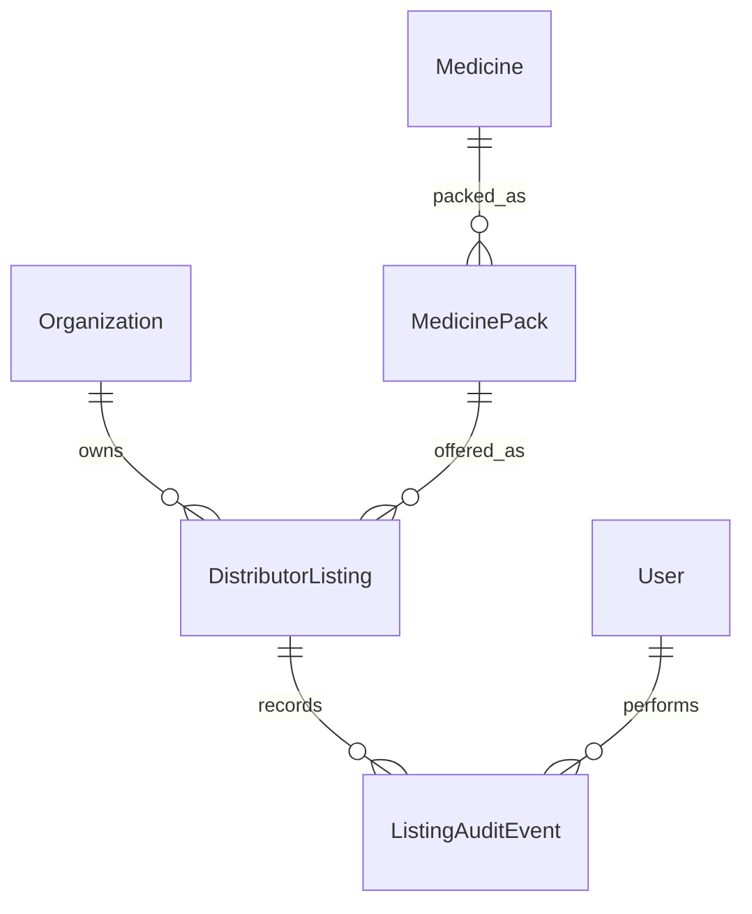

# Distributor listings

A listing is one distributor organization's offer for one canonical medicine pack. The medicine name, composition, manufacturer, and pack description stay on the catalog. The listing stores only the distributor's commercial and stock information.

## Lifecycle

`ACTIVE` listings can be paused or archived by a distributor owner or staff member. `PAUSED` can return to `ACTIVE` or be archived. `ARCHIVED` stays archived. A platform admin can move `ACTIVE` or `PAUSED` to `SUSPENDED`. Distributor users cannot change a suspended listing, and this task does not restore one.

There is one listing per distributor organization and medicine pack, including paused, archived, and suspended rows. Archiving does not free that pair for a second listing.

A distributor owner can store a proprietor name, landline, and mobile number on the organization profile. Those values are not copied onto each listing. Phone numbers are normalized to `+91` national form. Landline and mobile are each optional, and publishing the profile requires at least one valid number. Distributor staff can read the profile and cannot change it. Another distributor organization cannot read or edit it. Retailers and platform admins read published contact details from the wholesaler directory. Unpublished numbers stay off that directory, which then shows that contact details were not provided. Ordinary request logs record the actor and organization only.

Retailer discovery returns a listing only when all of these are true:

- listing status is `ACTIVE`
- the organization is a `DISTRIBUTOR` and its status is `ACTIVE`
- the medicine is `PUBLISHED` and search-visible

## Permissions

Distributor owners and distributor staff can create and edit listings for their own organization. That matches the role matrix: staff may update listings, and they still cannot change memberships. A membership in another distributor organization does not grant access. Retailers cannot create, pause, archive, or edit listings.

Platform admins can read listings for audit and suspend one. They cannot set the price or stock. A role, user id, or organization id in the request body is not authorization. The organization id is only the target of a membership check.

A suspended distributor organization cannot change its listings.

## Price, stock, and freshness

The unit price is indicative. It is not a confirmed quote. Currency is `INR` only. The price is a decimal and may be zero. The minimum order quantity must be a whole number of packs and greater than zero.

Stock status is `IN_STOCK`, `LOW_STOCK`, `OUT_OF_STOCK`, or `UNKNOWN`. A price or an active listing does not imply stock. Optional `availableQuantity` is the distributor's quantity on hand. It is not `MedicinePack.quantity`, and it does not change the stock status.

Price freshness and stock freshness are calculated when the listing is read. A timestamp within 7 days is `FRESH`. An older timestamp is `STALE`. A missing timestamp is `UNKNOWN`. Clients cannot submit freshness or timestamps. A price change refreshes only the price timestamp. A stock status or available-quantity change refreshes only the stock timestamp. Changing the minimum order quantity or the source note refreshes neither.

Freshness means the distributor updated the figure recently. It does not guarantee that the pack is available.

## Source

The source is `MANUAL` for every listing written by this API. The enum also reserves `CSV_IMPORT`, `API_INTEGRATION`, `SFTP_IMPORT`, `ERP_INTEGRATION`, and `POS_INTEGRATION`. Those channels are not implemented. An optional source note is free text supplied by the distributor. The API does not invent one.

## Distributor list

`GET /distributor/listings` is the distributor's own inventory, not retailer discovery. It requires an active distributor owner or staff membership for `organizationId`. Optional filters are `q`, `status`, and `stockStatus`, plus `page` and `pageSize`. `q` matches the pack description, the medicine display name, or the generic name. Paused, archived, and suspended rows remain in this list. Retailer search stays limited to active listings.

The web workspace uses this route from `/app/listings` when the selected organization is a distributor. Create and edit send only the commercial fields in the shared listing contracts. They do not send freshness, timestamps, or catalog changes.

## Discovery

`GET /listings` requires an active retailer membership or a platform admin. Filters are medicine, pack, distributor organization, stock status, and inclusive price range. Text search uses the catalog search document. Results are ordered by medicine name, then indicative price, then listing id. A lower price is not a recommendation. The response includes the canonical medicine and pack, the distributor's name, the indicative price, MOQ, stock status, and both freshness values. It does not include audit rows or the source note.

Retailers compare those listings at `/app/discover/listings`. The screen repeats that the price is indicative and that freshness is not availability.

## Audit

Listing changes are stored in `listing_audit_events`, not in the catalog audit table. Each row has the actor, distributor organization, listing, action, and time. Price and stock changes use separate actions. Distributor users cannot edit these rows. The API does not return them to retailers.

## Imports

Manual CSV and XLSX listing imports are documented in `docs/imports.md`. An upload creates a preview and does not change listings. API, SFTP, ERP, and POS imports are not implemented.

Orders, payments, and public supplier discovery are not implemented.
